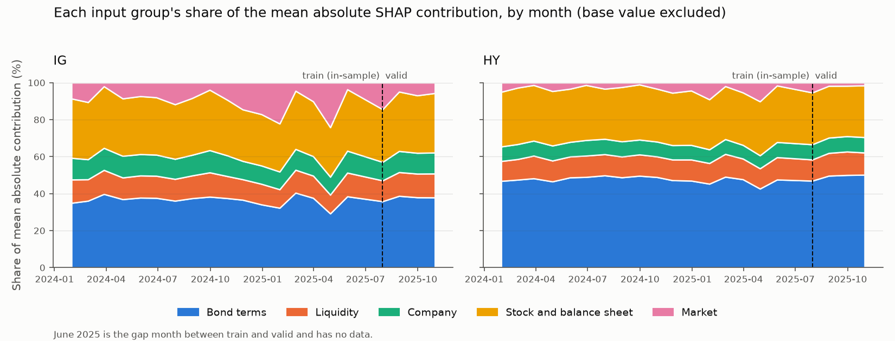

# Credit Spread Decomposition and ML Bond Pricer

Splits US corporate bond spreads into default, liquidity and risk premium parts using TRACE data, liquidity measures built in Spark, an ML default model, a Merton structural model, a company network in GraphFrames and CDS, then prices bonds from the Treasury curve plus an ML spread forecast.

## The question

How much of a US corporate bond's spread pays for expected default, how much pays for poor liquidity, and how much is a market-wide risk premium? How do those shares differ between investment grade and high yield, and how do they move over time?

The spread is the bond's yield minus the yield of the US Treasury with the same maturity, in basis points (100 bp = 1%). Structural models of default explain only part of it, above all for safe companies. This gap is known as the credit spread puzzle.

## Stages

Each stage is a [milestone](https://github.com/Smiggus/Credit-Spread-Decomp-ML/milestones), and each task in it is an issue. Stages run in this order:

| Step | Stage | What | Status |
|---|---|---|---|
| 1 | (a) | SHAP split of a gradient boosting spread model by input group | Done |
| 2 | (b) | Liquidity measures from trade-level TRACE in Spark | Done for 2024 to 2025; going back to 2002 is [#13](https://github.com/Smiggus/Credit-Spread-Decomp-ML/issues/13) |
| 3 | (c) | Merton model and a ladder of default classifiers, from Naive Bayes and logit to trees, boosting and an MLP | Not started |
| 3b | (c) | Survival, sequence and ensemble default models | Not started |
| 4 | (h) | 10-K and 10-Q parsing from SEC EDGAR: subsidiaries, default warnings, debt maturities, text tone | Not started |
| 5 | (d) | Company network in Spark GraphFrames: customer, supplier and parent links, ratings and contagion | Not started |
| 6 | (f) | Bond pricer: Treasury curve plus the predicted spread | Not started |
| 7 | (e) | CDS as the default part, bond spread minus CDS as the rest | Not started |
| 8 | (i) | LLM extraction from filings, checked against hand labels, and an explanation layer on the pricer | Not started |
| 9 | (g) | Dealer network, if dealer-level TRACE data ever becomes available | Off |

Each stage gets a short results section here when it is done.

## Results

### Stage a: what the spread model uses

An XGBoost model of the spread (500 trees, depth 10), trained on January 2024 to May 2025 and scored on July to October 2025, misses by 15.3 bp in IG and 50.3 bp in HY on average. Its SHAP values split each predicted spread into the five input groups. The split describes what the model relies on. Correlated inputs can trade credit between groups, so it is a description of the model and says nothing about cause. Spec: [`docs/specs/a_shap_split.md`](docs/specs/a_shap_split.md).


Share of the mean absolute contribution on the valid months, and the rise in valid error when the group is left out and the model refit:

| Input group | IG share | IG error rise | HY share | HY error rise |
|---|---|---|---|---|
| Bond terms (grade, maturity, coupon, seniority) | 40.5% | +6.5 bp | 51.5% | +5.8 bp |
| Stock and balance sheet | 33.1% | +1.7 bp | 29.6% | +10.2 bp |
| Company (sector, size of the bond program) | 11.8% | -0.1 bp | 9.2% | +4.0 bp |
| Market (Treasury curve, index spreads, VIX) | 7.7% | +2.1 bp | 3.7% | +3.7 bp |
| Liquidity (trade counts and volume) | 6.9% | -0.2 bp | 6.1% | +0.4 bp |

What this shows:

- **Bond terms carry the largest share**, about two fifths of the split in IG and half in HY. Leaving the group out raises IG error by 6.5 bp, 43% of the full model's 15.3 bp. The group includes the IG or HY flag; the flag's own effect was not tested separately.
- **In HY, the stock and balance sheet group matters most for accuracy.** Leaving it out raises HY error by 10.2 bp, more than leaving out bond terms (5.8 bp). The group's ten inputs were dropped together, so this does not say which of them matter. Stage c tests whether they measure default risk.
- **The market group's share is largest when the market inputs are far from their average.** On the train months (in-sample), it reaches 24.1% of the IG split in April 2025, when spreads widened, and 22.6% in January 2025, when they were tight. It is 2.5% in March 2024.
- **The five liquidity inputs barely move the model.** They take about 6% of the split, and leaving them out raises error by 0.4 bp in HY and not at all in IG. Differences this small are too small to read from one refit. Trading volume summed over each company's bonds sits in the company group, so liquidity's share here is a lower bound. Stage b adds standard liquidity measures from trade-level TRACE to them.

Tables: [`reports/a_group_shares.csv`](reports/a_group_shares.csv) (by grade, maturity and month, train months marked in-sample) and [`reports/a_drop_group.csv`](reports/a_drop_group.csv). Reproduce with `python -m scripts.a_shap_split` (about 8.5 minutes).

### Stage b: liquidity measures from TRACE

Stage b builds seven standard liquidity measures per bond and month from trade-level TRACE, adds them to the liquidity group, and reruns stage a. The trades cover public and 144A bonds from January 2024 to November 2025. Spark does the cleaning and the measures. Spec: [`docs/specs/b_liquidity.md`](docs/specs/b_liquidity.md).

The trades are cleaned with the post-2012 filters of Dick-Nielsen (2014). Of 97.2 million trade reports, 64.2 million are kept (66%). Most of the drop is the second report of an interdealer trade, which TRACE records once for each dealer.

| Step | Public | 144A |
|---|---|---|
| Trade reports | 89,010,636 | 8,189,131 |
| Cancel and reversal reports themselves | -685,971 | -142,564 |
| Cancelled trades | -675,099 | -138,436 |
| Reversed trades | -10,180 | -3,955 |
| Interdealer duplicates | -27,221,703 | -2,286,054 |
| When-issued, special or as-of trades, or settled over 7 days later | -1,623,959 | -248,302 |
| Kept | 58,793,724 | 5,369,820 |

The measures are Amihud and the imputed roundtrip cost, each with its within-month standard deviation, the Roll measure, the share of trading days without a trade, and lambda, which sums the first four after standardising them on the train months. Trades on a bond's snapshot day are left out, so the measures only use trades from before the spread they explain. On the valid months, HY bonds have a higher median Amihud, roundtrip cost, Roll measure and lambda than IG bonds.



Share of the mean absolute contribution on the valid months, and the rise in valid error when the group is left out and the model refit:

| Input group | IG share | IG error rise | HY share | HY error rise |
|---|---|---|---|---|
| Bond terms (grade, maturity, coupon, seniority) | 37.5% | +4.3 bp | 49.2% | +2.7 bp |
| Stock and balance sheet | 30.9% | +1.2 bp | 27.8% | +5.6 bp |
| Company (sector, size of the bond program) | 11.0% | -0.1 bp | 8.3% | +1.1 bp |
| Market (Treasury curve, index spreads, VIX) | 8.2% | +2.1 bp | 2.6% | +1.9 bp |
| Liquidity (trade counts and volume, plus the seven measures) | 12.4% | +0.4 bp | 12.1% | +2.5 bp |

What this shows:

- **The measures make the model more accurate.** Average error falls from 15.3 to 14.6 bp in IG and from 50.3 to 48.3 bp in HY.
- **In HY, liquidity now matters about as much as bond terms.** Leaving the liquidity group out raises HY error by 2.5 bp, against 0.4 bp in stage a and 2.7 bp for bond terms. In IG the rise is 0.4 bp. Each figure comes from one refit.
- **Liquidity's share of the split doubles, to about 12% in both grades.** Part of that may come from the group now holding twelve inputs instead of five. Correlated inputs spread the absolute contribution between them, so the error rise is the better guide to how much the group matters.
- **Leaving out the other groups costs less than in stage a.** In HY the rise for stock and balance sheet falls from 10.2 to 5.6 bp, and for company from 4.0 to 1.1 bp. The new measures may carry some of the same information, since trading costs and price swings are larger for bonds closer to default. Stage c's default models can test this.

Tables: [`reports/b_cleaning_counts.csv`](reports/b_cleaning_counts.csv), [`reports/b_liquidity_summary.csv`](reports/b_liquidity_summary.csv) (quartiles of each measure by grade and month, blank below five bonds), [`reports/b_group_shares.csv`](reports/b_group_shares.csv) and [`reports/b_drop_group.csv`](reports/b_drop_group.csv). Reproduce with `python -m scripts.b_liquidity` on the Spark server (about 13 minutes), then `python -m scripts.b_rerun_shap` (about 10 minutes).

## Data

The market data is licensed and is not in this repo. It comes from WRDS (TRACE Enhanced, CRSP, Compustat and Compustat customer segments) and a one-off Bloomberg CDS pull. Company filings come from SEC EDGAR, which is public. The code reads data from a local folder set in `.env`, and refuses any data path inside the repo. Results in this repo are totals and charts only.

## Layout

```
src/            package code (run modules from the repo root: python -m src.<module>)
  config.py     settings from config.yaml, paths from .env
  spark.py      builds the Spark session (Spark Connect or local)
scripts/        one-off jobs such as data exports
notebooks/      one notebook per stage, exploration only
reports/        write-up and figures (totals only)
docs/           method notes per stage
tests/          tests
config.yaml     project settings, safe to commit
.env.example    the machine-specific settings .env needs
```

## Setup

```
conda env create -f environment.yml
conda activate credit-spread-decomp
cp .env.example .env     # then fill in the paths
pytest
```

The Spark stages target Spark 4.2.0 on Scala 2.13 with GraphFrames 0.12.3. With a Spark Connect server, set `SPARK_REMOTE`; GraphFrames must be installed on the server. To run Spark locally instead, install `pyspark==4.2.0`, use Java 17 or 21, and set `GRAPHFRAMES_PACKAGE` to the GraphFrames build for Spark 4.x and Scala 2.13.

## How work is done

- `main` holds releases and is protected: changes reach it only by pull request from `dev`, with CI passing.
- `dev` is the working branch. Each issue gets a branch from `dev` (`feature/`, `docs/`, `chore/` or `ci/` plus a short name) and a pull request back into `dev`.
- PRs into `dev` do not close issues automatically, so close each issue by hand after its merge.
- **Spec first.** Each stage starts with a spec in `docs/specs/`: the result the stage must produce, the functions it needs and their acceptance tests. The acceptance tests are committed with the spec and skipped until their issue is done, so the skip ledger shows what is left. A stage is done when its result is produced and none of its tests are skipped.
- **Review every PR.** Before merging, the diff is read as a reviewer for unnecessary complexity, bugs, readability and tests, and the findings go in the PR's Review section. The topic is complex; the code should not be.
- **CI** (`lint-and-test`) runs on every pull request and push to `dev` and `main`: flake8, isort, radon (no function above complexity 10), pylint (10.00) and pytest with at least 90% branch coverage of `src/`.

## Licence

All rights reserved. See `LICENSE`.
